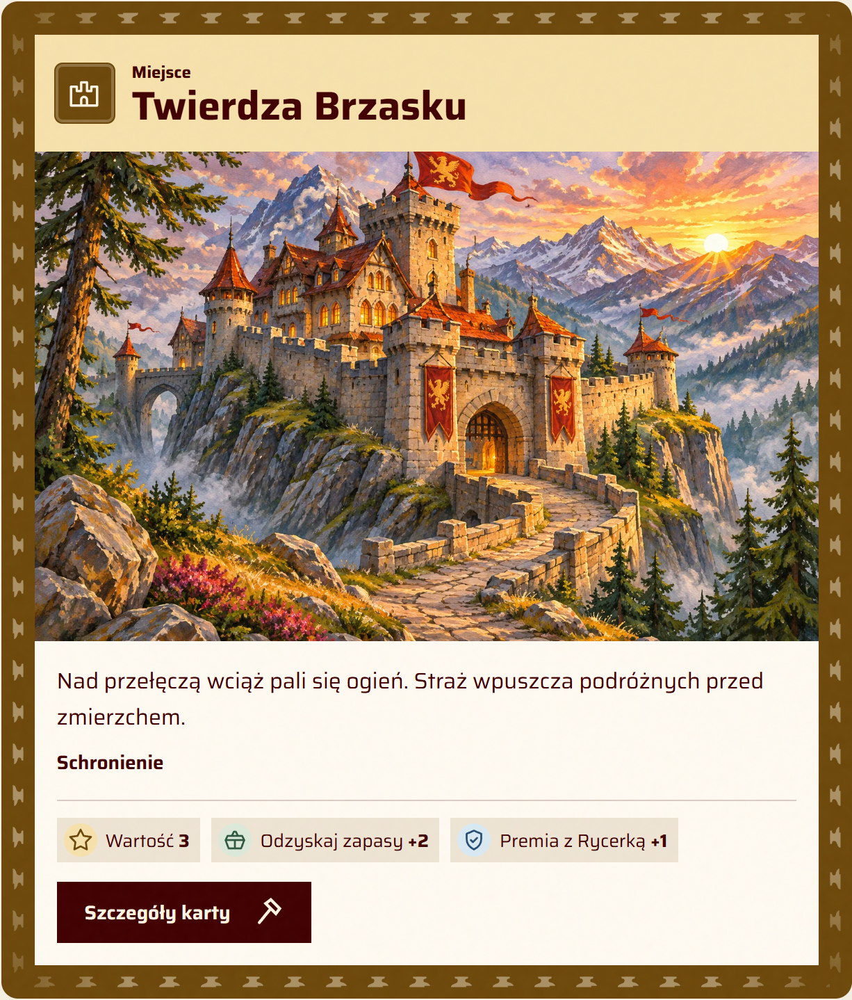

# Forge the Board — dokumentacja komponentów · v2

**Wersja do oceny · 15 listopada 2026**

Dokumentacja obejmuje 12 rodzin. Cztery źródła przejrzano w widokach 1440 i 390 px. Opis zakresu dotyczy jasnego interfejsu w języku polskim, z lokalnymi ciemnymi powierzchniami. Pokazane właściwości są osiami konfiguracji projektu, a nie umową API.

| Źródło | Zakres |
| --- | --- |
| S1 | [Direction Study v12](direction-study.html) — marka, podstawy, próbki komponentów, podgląd działającego listingu, szkice i dokumentacja ruchu. |
| S2 | [Strona główna](../index.html) — hero i tablet, warsztat, stół, FAQ, finał, stopka i dialog. |
| S3 | [Listing](../karty.html#talia) — hero, filtry, wyniki, karty i paginacja. |
| S4 | [Szczegóły „Twierdza Brzasku”](../karta.html?karta=twierdza-brzasku) — hero, parametry, reguła, zapis i karty powiązane. |

**Oznaczenia.** „Potwierdzone” oznacza element widoczny lub opisany w źródle. „Rekomendacja” jest wskazówką dla kolejnych projektów. „Do potwierdzenia” oznacza decyzję lub brak danych. „Do testu” wskazuje zachowanie wymagające weryfikacji we wdrożeniu. Wymiary pochodzą ze specyfikacji lub ze stylów przykładów. Nie stosowano szacunków pikseli z bitmap.

## Indeks

| Rodzina | Zastosowanie | Źródło |
| --- | --- | --- |
| [1. Marka](#1-marka) | Podpis marki, sygnet i ikona aplikacji | S1–S4 |
| [2. Nawigacja](#2-nawigacja) | Dostęp do sekcji, listingu i powrót | S2–S4 |
| [3. Hero i ilustracje](#3-hero-i-ilustracje) | Otwarcie strony i dekoracje tła | S1–S4 |
| [4. CTA i linki](#4-cta-i-linki) | Główne akcje i odsyłacze | S1–S4 |
| [5. Zakładki warsztatu](#5-zakładki-warsztatu) | Wybór jednego panelu | S1, S2 |
| [6. Karty i parametry](#6-karty-i-parametry) | Przegląd i porównanie elementów gry | S1–S4 |
| [7. Filtry i etykiety](#7-filtry-i-etykiety) | Zawężenie wyników i opis typu | S1, S3, S4 |
| [8. Paginacja](#8-paginacja) | Zmiana strony wyników | S1, S3 |
| [9. Pola tekstowe](#9-pola-tekstowe) | Wprowadzenie krótkiej wartości lub opisu | S1 |
| [10. Kontrolki wyboru](#10-kontrolki-wyboru) | Włączenie ustawienia i wybór opcji | S1 |
| [11. FAQ](#11-faq) | Odsłonięcie odpowiedzi przy pytaniu | S1, S2 |
| [12. Dialog](#12-dialog) | Krótkie objaśnienie w osobnym kontekście | S1, S2 |

## Fundamenty

| Rola | Wartość ze studium | Zastosowanie |
| --- | --- | --- |
| Papier | #F5EFE2 | Główne tło i wygaszenie hero |
| Ciemniejszy papier | #E9DFC9 | Powierzchnie wtórne |
| Bordo | #410001 | Tekst, aktywne filtry, bieżąca strona, drugorzędne CTA |
| Żar | #D82F00 | Akcent, sygnet i krótkie wprowadzenia |
| Wypełnienie CTA | #C42C00 | Główne CTA w próbce S1 |
| Tekst pomocniczy | #796859 | Opisy i podpisy |
| Szałwia | #B5B79B | Uzupełnienie palety |

**Typografia.** Saira 800, 34–72 px w próbce hero. Saira 700, 32 px dla tytułów sekcji. Saira 400, 16 px z interlinią 1,6 dla tekstu. IM FELL kursywą, 24 px w próbce wprowadzenia. To skala odniesienia. Konkretne strony mają własne responsywne wartości.

**Układ.** S1 rekomenduje rytm 4, 8, 12, 16, 24, 32 i 48 px. Dokumentacja podaje role wartości. Nazwy tokenów i pełny tryb ciemny pozostają do potwierdzenia. [S1 · kolor i typografia](direction-study.html#fundamenty)

**Dostępność.** Rekomendowany cel to WCAG 2.2 AA. Tekst ma próg 4,5:1, a duży tekst 3:1 przy co najmniej 18 pt lub 14 pt pogrubionych (1.4.3 AA). Informacja wizualna potrzebna do rozpoznania kontrolki lub stanu ma próg 3:1 względem sąsiednich kolorów, z wyjątkami m.in. dla wyłączonych kontrolek (1.4.11 AA). Cel wskaźnika ma minimum 24 × 24 CSS px albo spełnia wyjątek, np. dotyczący odstępu lub odsyłacza w tekście (2.5.8 AA). 44 px to zalecany rozmiar z S1. APG opisuje wzorce interakcji. Oględziny nie zastępują audytu. [WCAG 2.2](https://www.w3.org/WAI/WCAG22/quickref/) · [Wzorce APG](https://www.w3.org/WAI/ARIA/apg/patterns/)

## 1. Marka

- **Potwierdzone.** Poziomy logotyp łączy kowadło z napisem. Jasna i ciemna powierzchnia mają przypisane odrębne pliki logo. Sygnet to pojedyncze kowadło. Ikona aplikacji ma pełny napis „FORGE / the / BOARD” na jasnym, zaokrąglonym polu.
- **Układ i style.** Zachowuj liternictwo i proporcje SVG. Dziewięć kadrów moodboardu jest osobnymi obrazami i zawija się do kolejnych rzędów. Minimalna wielkość i pole ochronne są do potwierdzenia.
- **Rekomendacja.** W nagłówku użyj poziomego logo, a w ikonie aplikacji sprawdź czytelność wersji z tekstem w małej skali.
- **Do testu.** Link z logo ma nazwę wskazującą markę i cel. Dekoracyjny sygnet może mieć pusty opis alternatywny (1.1.1 A, 2.4.4 A). [S1 · marka](direction-study.html#logo) · [Ikona aplikacji](app-icon.svg)

## 2. Nawigacja

- **Potwierdzone.** Panel zawiera logo odsyłające do początku i linki do sekcji oraz kart. Na telefonie przycisk otwiera listę linków. Domyślnie lista jest zamknięta. „← Karty gry” w szczegółach prowadzi do nadrzędnego listingu. Stopka na home powtarza markę i oferuje powrót na górę.
- **Układ i style.** Papier, bordowe etykiety Saira, logo po lewej i linki po prawej. Na telefonie linki układają się w panelu poniżej przycisku. W listingu i szczegółach kolumna treści podąża za wewnętrzną krawędzią logo. Pokazano wyróżnienie „Karty gry” w nawigacji podstron.
- **Rekomendacja.** Używaj nazw celów, np. „Karty gry”. Przy powrocie może pomóc strzałka w lewo. Dopuszczalne długości podpisów i RTL są do potwierdzenia.
- **Do testu.** Tab przechodzi przez logo i linki. Przycisk menu zgłasza otwarcie i zamknięcie, a fokus pozostaje widoczny (2.1.1 A, 2.4.7 AA, 4.1.2 A). [S2 · nagłówek](../index.html) · [S4 · powrót](../karta.html?karta=twierdza-brzasku) · [APG · Disclosure](https://www.w3.org/WAI/ARIA/apg/patterns/disclosure/)

## 3. Hero i ilustracje

| Wariant | Potwierdzona kompozycja |
| --- | --- |
| Home · S2 | Mapa, wprowadzenie IM FELL, tytuł Saira, opis, CTA i tekstowy link. Mapa przechodzi do kadru tabletu podczas przewijania. |
| Listing · S3 | Niższe hero z mapą i CTA „Przejrzyj talię”. Opis ruchu przewiduje ujawnianie ilustracji jak malunku. |
| Szczegóły · S4 | Niższe hero z ilustracją karty, powrotem, typem, tytułem Saira i opisem kursywą IM FELL. Zapis jest w treści szczegółów. |

- **Układ.** Ilustracja wypełnia szerokość tła. Po prawej jest czytelny motyw, po lewej wygaszenie do papieru pod tekstem. Na telefonie ilustracja odsłania się pod tekstem. Dokładna wysokość zależy od widoku.
- **Szkice w tle.** Na home dziewięć konturowych ilustracji pojawia się w tle przy krawędziach, w niskim kryciu i z miejscowym wygaszeniem. Wzorzec nadaje się do sekcji tekstowych. Tło treści listingu i szczegółów pozostaje papierowe. Szkic animacji karty ma własną rolę.
- **Rekomendacja.** Wybierz kadr z głównym motywem po prawej i sprawdź, czy po zawinięciu tekst nadal znajduje się w jasnej części.
- **Do testu.** Kontrast za całym tytułem, reflow, pominięcie dekoracji w odczycie oraz statyczny układ przy ograniczonym ruchu (1.1.1 A, 1.4.3 AA, 1.4.10 AA, 2.3.3 AAA jako dodatkowe odniesienie). [S1 · hero](direction-study.html#mapa) · [S1 · szkice](direction-study.html#ilustracje) · [S3 · hero](../karty.html)

## 4. CTA i linki

| Kombinacja | Anatomia, stan i przykład |
| --- | --- |
| Główne CTA · S1–S3 | Prostokąt, żar, jasny podpis Saira, młotek po prawej. „Wejdź do kuźni” otwiera dialog. „Przejrzyj talię” prowadzi do sekcji. |
| Drugorzędne CTA · S1, S3–S4 | Bordo, jasny podpis, młotek. „Szczegóły karty” należy do linku całej karty. „Zapisz” i „Zapisano” to dwa stany akcji. |
| Link tekstowy · S2 | „Zajrzyj do warsztatu” bez wypełnienia, ze strzałką w dół. S1 pokazuje ten sam link w próbce przycisków i linków. |
| Wyłączony · S1 | Próbka „Niedostępny” ma stonowane kolory i nie animuje się. |

- **Wymiary i efekty.** W próbce podstawowej minimum 56 px wysokości, młotek 22 px. „Szczegóły karty” na listingu mają minimum 44 px wysokości. Hover unosi CTA w próbce o 2 px. Na hover i fokus młotek wykonuje pojedynczy zamach ok. 450 ms. Ograniczenie ruchu wyłącza zamach.
- **Rekomendacja.** Użyj linku do przejścia i przycisku do akcji. Dobieraj etykietę do wyniku działania. Dekoracyjny młotek zostaw w CTA, a strzałkę do przekazania kierunku.
- **Do testu.** Widoczny fokus, etykieta w nazwie, klawiatura i ogłoszenie zmiany stanu zapisu. Wzorzec przełącznika APG zaleca stałą etykietę przy stanie wciśnięcia. Para „Zapisz” i „Zapisano” wymaga sprawdzenia odczytu (2.1.1 A, 2.5.3 A, 4.1.2 A). [S1 · CTA](direction-study.html#cta) · [S4 · zapis](../karta.html?karta=twierdza-brzasku) · [APG · Button](https://www.w3.org/WAI/ARIA/apg/patterns/button/)

## 5. Zakładki warsztatu

- **Potwierdzone.** Trzy opcje przełączają jeden panel z mapą, kartami lub zasadami. Na home widoczne są numer, nazwa Saira i opis. Wybór wyróżnia żar. W studium opcje mają liniowe ikony 24 × 24 px o kresce 1,5 px, a aktywna próbka ma bordowe tło i jasny podpis.
- **Układ i warianty.** Pionowa lista obok podglądu na desktopie, trzy opcje nad panelem na telefonie. Na home domyślna jest mapa. Panel zależy od wybranej opcji. Zasada stosowania wersji z ikonami na przyszłych ekranach jest do potwierdzenia.
- **Rekomendacja.** Dla alternatywnych widoków tej samej treści użyj zakładek. Dla niezależnie odsłanianych odpowiedzi użyj FAQ.
- **Do testu.** Wybranie i powiązanie z panelem oraz zgodność klawiszy strzałek z orientacją listy (2.1.1 A, 2.4.3 A, 4.1.2 A). [S1 · ikony](direction-study.html#ikony) · [S2 · warsztat](../index.html#warsztat) · [APG · Tabs](https://www.w3.org/WAI/ARIA/apg/patterns/tabs/)

## 6. Karty i parametry

| Wariant | Anatomia i zastosowanie |
| --- | --- |
| Poglądowy · S2 | Kadr mapy, typ, tytuł, opis i wartość. Pokazuje przykład materiału stworzonego w warsztacie. |
| Listing i powiązane · S1, S3–S4 | Ikona typu, nazwa typu, tytuł, odrębna ilustracja fantasy, opis, rola i statystyki. „Szczegóły karty” jest częścią pojedynczego linku całej karty. |
| Szczegóły · S4 | Ilustracja przechodzi do hero, parametry i reguła mają osobny blok, a „Zapisz” jest w treści. |

| Typ S3–S4 | Tło i ramka | Emblemat |
| --- | --- | --- |
| Miejsce | #F6E1AC i #6D480B | Wieża |
| Sojusznik | #DCE9D9 i #305840 | Tarcza |
| Przygoda | #D9E9F2 i #264E72 | Iskra |
| Przedmiot | #E9DFC9 i #796859 | Klejnot |

- **Ramka i układ.** Pełna obwódka 24 px, promień 12 px. Małe kowadła biegną po czterech bokach z podstawami skierowanymi do środka. Odstęp odpowiada mniej więcej długości znaku, a wzór wygasa przy końcach boków. Odstęp między kartami listingu wynosi 28–44 px. Dwie kolumny przechodzą w jedną do 660 px. Długie tytuły i wiersze statystyk zawijają się. W listingu emblemat ma 44 × 44 px, blok opisu ma 16 px paddingu, a statystyki oddziela linia z 12 px odstępu nad nimi. CTA w karcie ma co najmniej 44 px wysokości.
- **Typografia i treść.** Tytuł Saira jest mocniejszy od podpisu typu. Statystyka ma kolorową ikonę, tekst i wartość, np. „Wartość 3”, „Odzyskaj zapasy +2” i „Premia z Rycerką +1”. Kolor kategorii jest niezależny od bordowego CTA. Szałwia oznacza Sojusznika.
- **Ruch.** Malunek jest stanem spoczynku. Hover lub widoczny fokus rozpoczyna przejście malunek → szkic z mocną ciągłą kreską w kolorze ramki → malunek, około 750 ms. Dotyk i ograniczony ruch zachowują statyczny malunek.
- **Rekomendacja.** Do porównania zostaw na karcie rolę i najważniejsze parametry. Pełny opis działania przenieś do szczegółów. Zachowaj tekst typu obok koloru i ikony. Wariant bez ilustracji i maksymalna liczba parametrów są do potwierdzenia. Widok „Nie znaleziono karty” dla nieznanego identyfikatora pokazuje komunikat i link powrotu do talii.
- **Do testu.** Rozróżnialne nazwy linków, kolejność odczytu parametrów, fokus poza ramką i ograniczony ruch (1.4.1 A, 2.4.4 A, 2.4.7 AA, 2.3.3 AAA jako dodatkowe odniesienie). [S1 · katalog](direction-study.html#katalog) · [S1 · ramka i animacja](direction-study.html#ramki-kart) · [S3 · listing](../karty.html#talia) · [S4 · szczegóły](../karta.html?karta=twierdza-brzasku)

## 7. Filtry i etykiety

- **Potwierdzone.** Chips to zaokrąglona kontrolka z tekstem. „Wszystkie” jest początkowo aktywne. S1 osadza listing S3 z tymi samymi typami: Miejsce, Sojusznik, Przygoda i Przedmiot. Aktywne bordo ma jasny tekst. Nieaktywne kategorie mają jasne tła typu i bordową nazwę. Etykieta karty opisuje typ, statystyka opisuje wartość.
- **Układ.** Saira półgruba, minimum 44 × 44 px i odstęp 8 px na listingu. Kontrolki zawijają się. Licznik to tekst pomocniczy. Wybór typu wraca do pierwszej strony wyników.
- **Rekomendacja.** Wybierz chips do „Pokaż Miejsca”, a etykietę do „To jest Miejsce”. Wielokrotny wybór kategorii pozostaje do potwierdzenia.
- **Do testu.** Stan przycisku, fokus, rozpoznanie wyboru także bez odcienia i ogłoszenie zmiany licznika (1.4.1 A, 2.4.7 AA, 4.1.2 A, 4.1.3 AA). [S1 · chipsy](direction-study.html#katalog) · [S3 · filtry](../karty.html#talia)

## 8. Paginacja

- **Potwierdzone.** „← Wstecz”, numery i „Dalej →”. Numer bieżący ma bordowe tło. Stan początkowy to 1. Na krańcach odpowiadający przycisk jest wyłączony. Listing pomija paginację, gdy dostępna jest tylko jedna strona.
- **Układ i style.** Prostokątne kontrolki Saira, 44 × 44 px minimum, odstęp 8 px, zawijanie. Samodzielne kontrolki ze strzałkami bez tekstu i wielokropek dla długich zakresów są do potwierdzenia.
- **Rekomendacja.** W sekwencji stron zachowaj tekst kierunku i numer. Do powrotu ze szczegółów użyj odsyłacza do listingu.
- **Do testu.** Stan „bieżąca strona”, czytelne nazwy numerów i fokus po wymianie wyników (2.4.3 A, 2.4.7 AA, 4.1.2 A). [S1 · katalog](direction-study.html#katalog) · [S3 · paginacja](../karty.html#talia)

## 9. Pola tekstowe

- **Próbka S1.** Jednowierszowa „Nazwa projektu” z placeholderem i pomocą, „Adres e-mail” z błędem oraz wielowierszowy „Opis świata”. Anatomia to stała etykieta, wartość i opcjonalny tekst pomocy lub błędu. Błąd jest opisany tekstem i obrysem.
- **Układ i style.** Etykieta Saira w bordo, jasna powierzchnia, obrys w kolorze pomocniczym. Najmniejsza wysokość pola w próbce to 44 px, szerokość wypełnia kontener. Moment walidacji, obowiązkowość i wyłączenie pola pozostają do potwierdzenia.
- **Rekomendacja.** Placeholder może podawać „Wybrzeże Gryfów”. Etykieta „Nazwa projektu” pozostaje widoczna po wpisaniu wartości. Komunikat powinien wyjaśniać poprawkę.
- **Do testu.** Powiązanie etykiety i pomocy, odczyt błędu, czytelność po powiększeniu (1.4.1 A, 3.3.1 A, 3.3.2 A, 3.3.3 AA, 4.1.2 A). [S1 · pola](direction-study.html#komponenty)

## 10. Kontrolki wyboru

Próbki formularza mają własną sekcję. Obecny listing filtruje według typu i dzieli wyniki na strony. Zapis karty jest w szczegółach.

| Wariant S1 | Anatomia i pokazywana konfiguracja |
| --- | --- |
| Checkbox | Kwadrat z haczykiem przy niezależnej opcji. „Pokaż projekty koncepcyjne” jest początkowo niezaznaczone. To próbka formularza w studium. |
| Radio | Koło z kropką i podpis. Próbka formularza „Kolejność” zawiera „Kolejność talii”, aktywną początkowo, i „Od najwyższej wartości”. |
| Select | Etykieta nad polem, wartość i wskaźnik rozwinięcia. „Typ projektu” ma warianty planszowa, karciana i fabularna. Wyłączony „Dostęp” pokazuje „Tylko właściciel”. |

- **Układ i style.** Tekst Saira obok kontrolki lub nad polem. Grupa radio ma legendę. Select ma jasne tło, obrys i minimum 44 px. Wielkość natywnych znaczników zależy od przeglądarki. Stan częściowego zaznaczenia i błąd grupy są do potwierdzenia.
- **Rekomendacja.** Checkbox sprawdza się przy niezależnym „Tylko zapisane”, radio przy kilku widocznych opcjach wzajemnie wykluczających się, select przy wyborze jednej wartości z rozwijanej listy.
- **Do testu.** Nazwa opcji i grupy, zmiana klawiaturą oraz stan wyłączenia (2.1.1 A, 3.3.2 A, 4.1.2 A). [S1 · kontrolki formularza](direction-study.html#komponenty) · [APG · Checkbox i Radio Group](https://www.w3.org/WAI/ARIA/apg/patterns/)

## 11. FAQ

- **Potwierdzone.** Pytanie i wskaźnik tworzą wiersz, a odpowiedź rozwija się poniżej. Home pokazuje plus dla zwinięcia i minus dla rozwinięcia. Pierwsze pytanie jest otwarte na starcie. S1 pokazuje oba stany i wskazuje Enter oraz Spację.
- **Układ i style.** Pogrubione pytanie Saira, mniejsza odpowiedź, papierowe tło i linie podziału. Na telefonie FAQ schodzi pod opis projektu. Minimalny rozmiar aktywnego wiersza jest do potwierdzenia.
- **Rekomendacja.** Grupuj w wierszu jedno pytanie z bezpośrednią odpowiedzią, np. „Co mogę zobaczyć już teraz?”.
- **Do testu.** Przełączenie klawiaturą, odczyt stanu i pominięcie zwiniętej treści (2.1.1 A, 4.1.2 A). [S1 · FAQ](direction-study.html#komponenty) · [S2 · status projektu](../index.html) · [APG · Disclosure](https://www.w3.org/WAI/ARIA/apg/patterns/disclosure/)

## 12. Dialog

- **Potwierdzone.** „Kuźnia dopiero nabiera kształtów” na home i „Forge the Board powstaje” w S1 otwierają się z CTA. Zawiera tytuł, wyjaśnienie i sposób zamknięcia. Home ma „×” i dalszą akcję do warsztatu. S1 pokazuje tekstowe „Zamknij”. Początkowo dialog jest zamknięty.
- **Układ i style.** Jasna powierzchnia na przyciemnionym tle, bordowy nagłówek Saira, na home także wprowadzenie IM FELL. Panel jest wyśrodkowany i może przewijać treść w niskim widoku. Wymiary różnią się między próbką i home.
- **Rekomendacja.** Dialog sprawdza się przy krótkim objaśnieniu etapu projektu. Dla odpowiedzi na kilka pytań użyj FAQ. Zostaw widoczne zamknięcie przy dłuższym tłumaczeniu.
- **Do testu.** Escape i przycisk zamykają okno, klawiatura pozostaje w nim podczas otwarcia, tytuł jest ogłaszany, a po zamknięciu fokus wraca do właściwej kontrolki. Po przejściu do warsztatu sprawdź fokus przy celu (2.1.1 A, 2.4.3 A, 2.4.11 AA, 4.1.2 A). [S1 · dialog](direction-study.html#komponenty) · [S2 · CTA](../index.html) · [APG · Modal Dialog](https://www.w3.org/WAI/ARIA/apg/patterns/dialog-modal/)

## Otwarte kwestie

| Kwestia | Decyzja potrzebna przy kolejnym użyciu |
| --- | --- |
| Warsztat z S1 i warsztat na home | Czy wariant z ikonami stosujemy na nowych stronach warsztatu? |
| Typy kart w kolejnych grach | Studium i listing używają typów „Wybrzeża Gryfów”. Pozostaje ustalić, czy kolejne talie mogą definiować własne typy. |
| Pola, walidacja i lokalizacja | Jak obsługujemy obowiązkowość, moment walidacji, długie tłumaczenia i RTL? |
| Kierunkowe kontrolki bez podpisu | Samodzielny wariant przewijania wymaga przykładu i nazwy dostępnej. |
| Dostępność | Kontrast nad ilustracjami, powiększenie, klawiatura i ogłoszenia czytnika wymagają osobnych testów wdrożeniowych. |
